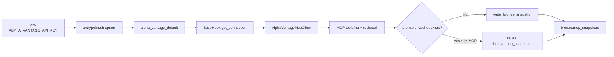
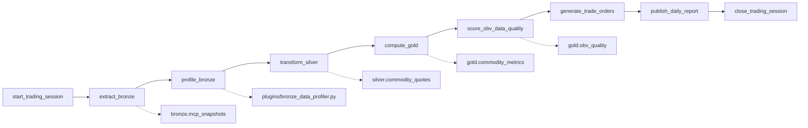

# Airflow Sample Project

Containerized **Apache Airflow 3.3.1** (Python 3.12) with PostgreSQL, Redis, and sample DAGs. Commodity prices come from the [Alpha Vantage MCP server](https://mcp.alphavantage.co/#connection-examples).

## Quick Start

**Prerequisites:** Docker Compose, a free [Alpha Vantage API key](https://www.alphavantage.co/support/#api-key), local Python **3.12+** for tests.

> **Where to run Compose:** Linux or WSL on Windows. MCP defaults to a bundled local stdio process inside the Airflow container; it requires outbound internet access to Alpha Vantage but no MCP port-forwarding service.

```bash
cp .env.example .env
# Set ALPHA_VANTAGE_API_KEY — never commit .env
docker compose up -d --build
```

UI: [http://localhost:8080](http://localhost:8080) (`admin` / `admin`).

```bash
docker compose down
```

## Secrets (Connection, not `.env` at runtime)

`.env` is **boot seed only**. `entrypoint.sh` upserts Airflow Connection `alpha_vantage_default` (SQL delete-then-insert under a Postgres advisory lock):

| Field | Source |
|-------|--------|
| conn-password | `ALPHA_VANTAGE_API_KEY` |
| extra `transport` | `ALPHA_VANTAGE_TRANSPORT` (default `stdio`) |
| extra `mcp_url` | compose default `https://mcp.alphavantage.co/mcp` |
| extra `mcp_sse_url` | compose default `https://mcp.alphavantage.co/sse` |

Tasks read the key and extras with `BaseHook.get_connection('alpha_vantage_default')` (metadata DB fallback outside a task; env fallback for unit tests). Compose pins `AIRFLOW__CORE__FERNET_KEY` so every service can decrypt the password.

Production: use an Airflow secrets backend. Do not rely on `.env`. The key is never committed; task logs redact `apikey=` query values.

## MCP transport

| `ALPHA_VANTAGE_TRANSPORT` | Path |
|---------------------------|------|
| `http` | Streamable HTTP |
| `sse` | Legacy HTTP+SSE |
| `stdio` (default) | Bundled `marketdata-mcp` subprocess in the Airflow container; MCP 1.12.3 and Pydantic 2.11.7 are pinned for compatibility |
| `rest` | Legacy `www.alphavantage.co/query` (not MCP) |

In the default local mode, Airflow launches the official MCP server as a bundled stdio subprocess inside its own container; no host-network forwarder, runtime package download, or MCP port is used. The server still requires outbound internet access to call Alpha Vantage.

For an explicit remote `http` or `sse` transport, set the corresponding MCP URL in `.env`; direct URLs are the default supported route for Docker Desktop and WSL. The host-network forwarder is not used by the local stdio setup.

**Optional Linux/CI forwarder** (only for bridges that cannot reach the internet directly): `host:18080` → `mcp.alphavantage.co:443`.

```bash
docker compose -f docker-compose.yml -f docker-compose.mcp-forwarder.yml up -d --build
# and in .env:
# ALPHA_VANTAGE_MCP_URL=https://mcp.alphavantage.co:18080/mcp
# ALPHA_VANTAGE_MCP_SSE_URL=https://mcp.alphavantage.co:18080/sse
```

**Windows Desktop UI caveat** (from real use): published ports such as Airflow `8080` can still fail under Desktop’s Windows port forwarding even with a working MCP URL. Run Compose from **Linux** or **WSL** for the UI.

## Sample DAGs

1. Enable and trigger **`alpha_vantage_mcp_read`** (manual): `list_mcp_tools` (`TOOL_LIST`) then `read_wti_monthly` (`TOOL_GET` + `TOOL_CALL` WTI monthly).
2. **`commodity_trading_dag`** runs every 2 minutes until paused; it processes gold, WTI, wheat, copper, and natural gas.

## Workflow schema

**Medallion** here is a warehouse pattern (not a commodity and not an Airflow feature): raw **Bronze**, cleaned **Silver**, business-ready **Gold**. This sample maps that onto `commodity_trading_dag` tasks and Postgres schemas of the same names.

| Layer | Meaning | This DAG |
|-------|---------|----------|
| Bronze | Immutable raw extract | `extract_bronze` → `bronze.mcp_snapshots` |
| Profile | Stats / fail-or-warn before silver | `profile_bronze` (plugin `bronze_data_profiler`) |
| Silver | Validated / typed tables | `transform_silver` → `silver.commodity_quotes` |
| Gold | Metrics a BI tool can read | `compute_gold` → `gold.commodity_metrics`; `score_obv_data_quality` → `gold.obv_quality` |

How Connection `alpha_vantage_default` feeds bronze, then the `commodity_trading_dag` task graph (names match `commodity_dag.py`).



`extract_bronze` opens `AlphaVantageMcpClient` only when a symbol still needs a fetch (`ALPHA_VANTAGE_TRANSPORT=rest` uses `_alpha_vantage_rest_get` instead of MCP).



`profile_bronze` is a custom plugin module (`plugins/bronze_data_profiler.py`) that runs after bronze and before silver. Missing or unparseable snapshots fail the task (set `BRONZE_PROFILE_FAIL_ON_ERROR=false` to warn-only). Short series (e.g. GOLD spot fallback) and high placeholder rates warn so the sample still runs. `score_obv_data_quality` remains after `compute_gold`. Silver also writes `silver.commodity_price_series`; gold SQL is `compute_gold_metrics_sql`.

## Medallion (`commodity_trading_dag`)

Postgres schemas `bronze` / `silver` / `gold` (same instance as Airflow metadata) plus JSON under `data/medallion/`.

| Task | Layer | What it writes |
|------|-------|----------------|
| `extract_bronze` | Bronze | Immutable MCP/REST payload (`bronze.mcp_snapshots` + `data/medallion/bronze/<ds>/<symbol>.json`). **Skips MCP** if that snapshot already exists. |
| `profile_bronze` | Quality | Row counts, numeric coverage, placeholder rate, duplicate dates. **Errors fail**; short/sparse series **warn**. |
| `transform_silver` | Silver | Schema / nulls / non-positive checks → `silver.commodity_quotes`, `silver.commodity_price_series` |
| `compute_gold` | Gold | **SQL** metrics in `gold.commodity_metrics` (latest/min/max/avg, count, period return) plus weighted signals |
| `score_obv_data_quality` | Gold | Synthetic-volume `compute_obv_signal` vs linear price trend → `gold.obv_quality` |
| `generate_trade_orders` | — | Notional BUY/SELL orders |
| `publish_daily_report` | — | Summary including gold metrics and OBV quality scores |

BI can read `gold.commodity_metrics` and `gold.obv_quality`. Unit tests use SQLite + temp JSON.

On retry you should see `Reusing bronze snapshot for GOLD ... (skip MCP)` instead of another live fetch.

## Signals

Commodity MCP series have no volume; `compute_obv_signal` uses `|price change|` as a proxy. `score_obv_data_quality` scores that proxy against the actual price trend line.

| Function | Default weight |
|----------|----------------|
| `compute_momentum_signal` | 0.15 |
| `compute_moving_average_signal` | 0.25 |
| `compute_rsi_signal` | 0.25 |
| `compute_macd_signal` | 0.25 |
| `compute_obv_signal` | 0.10 |

Weighted score: **BUY** ≥ `0.25`, **SELL** ≤ `-0.25`, else **HOLD**.

| Symbol | MCP tool | Interval |
|--------|----------|----------|
| `GOLD` | `GOLD_SILVER_HISTORY` (spot fallback) | monthly default (daily optional) |
| `CRUDE_OIL` | `WTI` | monthly default (daily optional) |
| `NATURAL_GAS` | `NATURAL_GAS` | monthly default (daily optional) |
| `COPPER` | `COPPER` | monthly only |
| `WHEAT` | `WHEAT` | monthly only |

Free-tier ~5 req/min; pause defaults to 15s between calls (`ALPHA_VANTAGE_REQUEST_PAUSE_SECONDS`). `commodity_trading_dag` allows one active run to avoid overlapping API calls.

## Project structure

```
default/                       # this Airflow project
├── Dockerfile
├── docker-compose.yml      # api-server, scheduler, dag-processor, postgres, redis (direct MCP)
├── docker-compose.mcp-forwarder.yml  # opt-in host-network MCP forwarder (Linux/CI)
├── entrypoint.sh           # migrate, admin user, Connection seed, warehouse DDL
├── requirements.txt
├── .env.example
├── dags/
│   ├── alpha_vantage_mcp.py           # MCP client + Connection helpers
│   ├── medallion.py                   # bronze/silver/gold I/O
│   ├── alpha_vantage_mcp_read_dag.py
│   ├── commodity_dag.py
│   └── sample_dag.py
├── plugins/
│   └── bronze_data_profiler.py        # Bronze → Silver profiling
└── tests/                  # mocked MCP + profiler; no live key

terraform/                  # repo-root sibling of default/: optional AWS S3 (+ RDS)
```

## Environment variables

See `docker-compose.yml` for Airflow. Commodity / MCP:

- `ALPHA_VANTAGE_API_KEY` — seeds Connection `alpha_vantage_default` (do not commit `.env`)
- `ALPHA_VANTAGE_TRANSPORT` — `stdio` by default; also `http` / `sse` / `rest`
- `ALPHA_VANTAGE_MCP_STDIO_COMMAND` / `ALPHA_VANTAGE_MCP_STDIO_ARGS` — local server command and arguments
- `ALPHA_VANTAGE_MCP_URL` / `ALPHA_VANTAGE_MCP_SSE_URL` — direct remote endpoints when using `http` or `sse`
- `MEDALLION_DATA_DIR` — default `/app/data/medallion`
- `ALPHA_VANTAGE_INTERVAL` — `monthly` (default) or `daily`
- `ALPHA_VANTAGE_REQUEST_PAUSE_SECONDS` — default `15` (free-tier rate-limit spacing)
- `SIGNAL_WEIGHT_*` / `SIGNAL_BUY_THRESHOLD` / `SIGNAL_SELL_THRESHOLD`
- `BRONZE_PROFILE_FAIL_ON_ERROR` — default `true` (fail the DAG on empty/unparseable bronze)
- `BRONZE_PROFILE_WARN_MIN_POINTS` — default `5` (spot quotes warn, they do not fail)

## Local vs AWS

Compose is a **local stand-in for the same roles** as managed AWS — Postgres, object files, Redis, and the Airflow control plane. It does **not** auto-deploy to AWS. `docker compose up` stays on your machine.

| Local | AWS |
|-------|-----|
| Local Docker Postgres (Airflow metadata and `bronze` / `silver` / `gold`) | AWS RDS (PostgreSQL) |
| Local `data/medallion/` JSON drops | AWS S3 (raw object data lake) |
| Containerized Redis (Compose service; this sample does not use it as a Celery broker) | AWS ElastiCache (Redis) |
| Local Docker executor (`AIRFLOW__CORE__EXECUTOR: LocalExecutor` in `docker-compose.yml`; not Celery) | AWS MWAA (Managed Apache Airflow) |

Repo-root [`../terraform/`](../terraform/README.md) already sketches a versioned S3 bronze bucket and optional RDS Postgres. It does not create MWAA or ElastiCache. Do not commit credentials; CI does not apply Terraform.

## Infrastructure as code

See [Local vs AWS](#local-vs-aws) and [`../terraform/`](../terraform/README.md). Local Compose Postgres is enough to run this sample.

## Tests

From `default/`:

```bash
PYTHONPATH=dags:plugins python -m unittest discover -s tests -v
```

Mocked MCP session + temp SQLite warehouse. No live key required.

## Services & troubleshooting

- UI `8080` · Postgres `5432` · Redis `6379` · LocalExecutor · Simple Auth Manager (`admin`/`admin`)
- Postgres holds Airflow metadata **and** `bronze` / `silver` / `gold`

If a run stays `queued`: rebuild, and confirm `AIRFLOW__CORE__EXECUTION_API_SERVER_URL=http://airflow-api-server:8080/execution/` (service name, not `localhost`). Then `docker compose logs airflow-scheduler --tail=200`.
